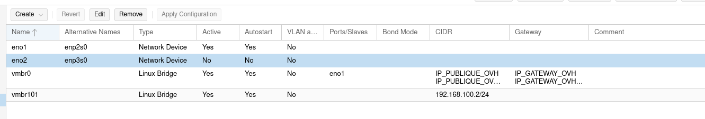

# Réseau interne : VLAN et règles entre VLAN

**Conception faite, mise en œuvre à faire.** Aucun VLAN n'est encore créé. Cette page fixe le plan d'adressage, la place de l'hôte et les flux autorisés, avant de créer la moindre VM.

## Principe : un VLAN par rôle, pas par application

Je découpe le réseau selon ce que fait une machine (entrée, application, données, administration), et non selon l'application qu'elle héberge. L'application est un paramètre : je peux la changer sans redessiner le réseau. Le moteur de base de données n'est lui aussi qu'un port à autoriser entre deux VLAN.

## Plan d'adressage

| VLAN | Rôle | Réseau | Passerelle (pfSense) |
|---|---|---|---|
| (sans étiquette) | Réseau hyperviseur : l'hôte Proxmox, le LAN de pfSense | `192.168.100.0/24` | `192.168.100.1` |
| **10** | DMZ : reverse proxy, WAF | `10.10.10.0/24` | `10.10.10.1` |
| **20** | APP : serveur web | `10.10.20.0/24` | `10.10.20.1` |
| **30** | DATA : base de données | `10.10.30.0/24` | `10.10.30.1` |
| **40** | MGMT : sauvegarde, supervision, poste d'administration | `10.10.40.0/24` | `10.10.40.1` |
| (VPN) | WireGuard, mon PC | `10.6.0.0/24` | pfSense `10.6.0.1` |

L'identifiant du VLAN est aussi le troisième octet de son réseau : `10.10.<id>.0/24`. Les plages ne chevauchent ni le réseau hyperviseur ni celui du VPN.

## Où vit l'hôte Proxmox

L'hôte reste dans son propre réseau, `192.168.100.0/24`, et **n'a aucune adresse dans les VLAN**. Je ne le place pas dans MGMT, alors que ma première version du README l'y mettait.

| | Hôte dans son réseau | Hôte dans MGMT |
|---|---|---|
| Un flux vers l'hôte | passe par pfSense : une règle explicite par flux | reste dans le même VLAN : **aucun filtrage** par pfSense |
| Si Grafana est compromis | il ne joint l'hôte que sur les ports autorisés | il est à un pas de l'hôte, seul nftables l'arrête |
| Déplacer l'hôte | rien à faire | nouvelle adresse sur l'hôte, règles du VPN, de nftables et de Fail2ban à refaire, risque de couper mon accès |

Le coût est de quelques règles de plus entre MGMT et le réseau hyperviseur, visibles et documentées. L'accès à l'hôte par le SSH direct, l'interface web et le tunnel passe par `vmbr0` et ne dépend pas de pfSense : si pfSense tombe, je garde la main.

## Ce que contient MGMT

| VM | Rôle | Flux |
|---|---|---|
| Proxmox Backup Server | sauvegarde des VM (règle 3-2-1-1-0) | l'hôte lui envoie les sauvegardes (port 8007) |
| Prometheus, Grafana, Alertmanager | métriques et alertes | Prometheus interroge chaque machine (port 9100) et l'API de Proxmox (8006) |
| Journaux centralisés (facultatif) | regrouper les logs des VM | les VM envoient leurs logs vers MGMT |
| Poste d'administration (facultatif) | Ansible, rebond SSH | SSH vers les autres VLAN |

## Flux entre VLAN : tout est refusé par défaut

| De | Vers | Autorisé | Port |
|---|---|---|---|
| Internet | DMZ | oui | 80 et 443 |
| DMZ | APP | oui | le port de l'application |
| APP | DATA | oui | le port de la base (3306 pour MariaDB, 5432 pour PostgreSQL) |
| MGMT | tous les VLAN | oui, en initiateur | SSH, exportateurs de métriques (9100) |
| MGMT | réseau hyperviseur | oui, en initiateur | 9100 et 8006 (supervision) |
| Réseau hyperviseur (hôte) | MGMT | oui, en initiateur | 8007 (sauvegarde) |
| VPN (`10.6.0.2`) | VLAN et réseau hyperviseur | oui | SSH, interface de l'hôte (8006), interface de pfSense |
| DMZ, APP, DATA | Internet | restreint | mises à jour seulement |
| **DMZ, APP, DATA** | **réseau hyperviseur** | **non** | |
| Tout le reste | | non | |

Cette règle est ce qui ferme l'hôte aux futures VM : une VM d'un VLAN ne peut atteindre `192.168.100.2` qu'en traversant pfSense, qui refuse. nftables sur l'hôte est la seconde barrière, au cas où pfSense serait mal configuré.

## État actuel du réseau de l'hôte, avant la mise en œuvre

- `vmbr0`, relié à la carte `eno1`, porte l'IP publique de l'hôte (IPv4 et IPv6) et la passerelle d'OVH.
- `vmbr101` est le réseau privé `192.168.100.2/24`, sans port physique : c'est le réseau de transit de l'hôte et le LAN de pfSense.
- La colonne « VLAN aware » est à `No` pour les deux bridges : aucun VLAN n'existe encore. C'est l'état de départ de la mise en œuvre.
- La seconde carte, `eno2`, est inactive.

## Mise en œuvre, à faire

1. nftables sur l'hôte : fermer les ports 22 et 8006 aux sources autres que le VPN et mon IP.
2. Passer `vmbr101` en mode VLAN (`bridge-vlan-aware`), sans toucher à l'adresse de l'hôte.
3. Dans pfSense : créer les VLAN 10 à 40 sur l'interface LAN, les assigner, leur donner leur passerelle.
4. Écrire les règles entre VLAN, en refus par défaut, puis les tester une à une.
5. Créer les VM, chacune avec une étiquette de VLAN sur son interface, des clés SSH seules, Fail2ban et un pare-feu local.

## Points ouverts

- L'application de démonstration : Agora Project (PHP et MariaDB) à ce stade. Elle suit l'architecture, et non l'inverse.
- Le DNS interne (Unbound sur pfSense) pour résoudre les noms des VM.
