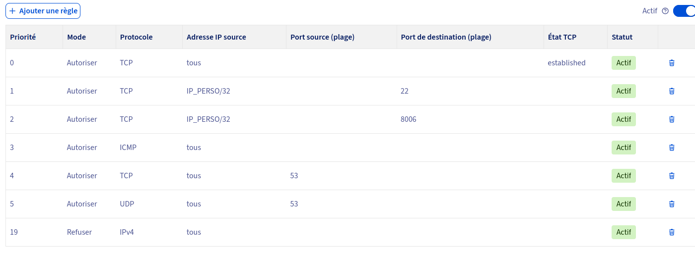
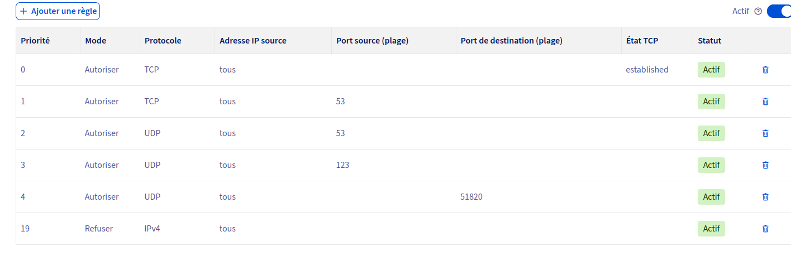
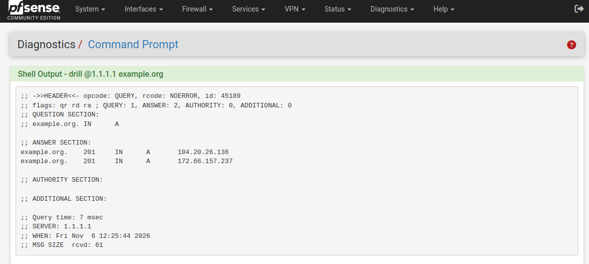
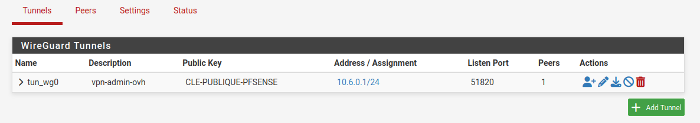
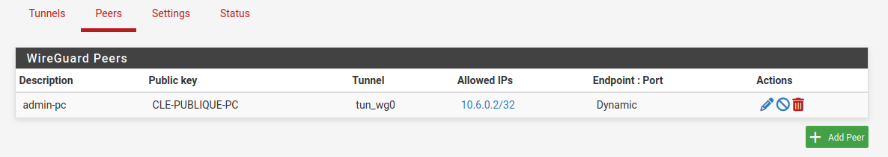
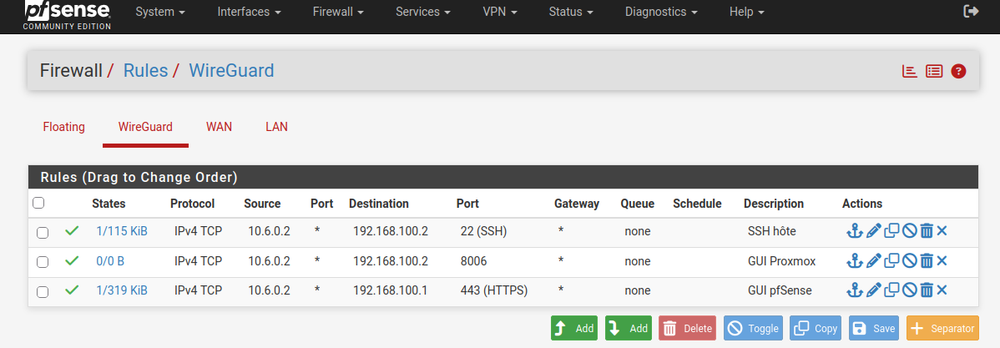

# Sécurité — règles choisies et mise en place

Liste des mesures de sécurité du lab, une par une. Le statut est mis à jour au fur et à mesure.

## Le principe : plusieurs barrières, pas une seule

Chaque mesure bloque un type de problème différent. Aucune ne remplace les autres.

| Barrière | Elle sert à... |
|---|---|
| Firewall OVH | Décide qui a le droit d'atteindre le serveur, avant même d'y arriver |
| pfSense / VLAN | Décide quelles parties du réseau interne peuvent se parler entre elles |
| nftables (sur chaque machine) | Décide qui peut joindre quelle machine précise, sur quel port |
| SSH sécurisé | Décide comment on a le droit de se connecter à une machine |
| Clé de tunnel restreinte | Limite ce que mon accès de tous les jours peut atteindre : deux interfaces web, sans shell |
| VPN WireGuard (pfSense) | Donne accès au réseau interne avec une clé, sans dépendre de mon IP |
| Fail2ban | Bloquer automatiquement une IP qui essaie de se connecter trop de fois |
| WAF (reverse proxy) | Vérifie qu'une requête web n'est pas suspecte |

## Les accès au lab, une fois tout en place

| Accès | Chemin | Dépend de | Usage |
|---|---|---|---|
| SSH avec l'utilisateur d'administration (clé avec shell) | PC → port 22 | règle OVH sur mon IP | administration en ligne de commande |
| Tunnel SSH (clé dédiée) | PC → port 22 → GUI pfSense et GUI Proxmox | règle OVH sur mon IP | accès aux interfaces web |
| GUI Proxmox directe | `IP-DU-SERVEUR:8006` | règle OVH sur mon IP + TOTP | dernier recours |
| VPN WireGuard | PC → IP failover (UDP) → LAN | VM pfSense en marche | accès aux interfaces web, sans dépendre de mon IP |
| Console série (SOL) et rescue OVH | manager OVH | compte OVH uniquement | secours quand le SSH ne passe plus |

La console du manager OVH ne dépend ni du réseau du serveur, ni de pfSense, ni du SSH : c'est la dernière porte.

## Firewall OVH — sur l'IP principale

**Fait.**

S'applique à l'IP principale du serveur (`IP-DU-SERVEUR`), celle qui donne accès à Proxmox (`:8006`) et au SSH (`:22`).

| Priorité | Action | Protocole | IP source | Port source | Port destination | État TCP |
|---|---|---|---|---|---|---|
| 0 | Autoriser | TCP | tous | - | - | established |
| 1 | Autoriser | TCP | mon IP perso | - | 22 | - |
| 2 | Autoriser | TCP | mon IP perso | - | 8006 | - |
| 3 | Autoriser | ICMP | tous | - | - | - |
| 4 | Autoriser | TCP | tous | 53 | - | - |
| 5 | Autoriser | UDP | tous | 53 | - | - |
| 19 | Refuser | IPv4 | tous | - | - | - |

Ce pare-feu ne suit pas les connexions (le manager précise que « established » s'appuie sur les indicateurs TCP, pas sur un suivi de session) : la règle `established` (la première) est ce qui laisse revenir les réponses TCP aux connexions lancées depuis le serveur. Pour le DNS, les deux règles avec le port source 53 (TCP et UDP) laissent revenir les réponses des résolveurs. L'ICMP autorisé permet de tester avec `ping`. La dernière règle refuse tout le reste.



**Vérifié** : `apt update`, la résolution DNS et la synchronisation de l'heure fonctionnent. Il n'y a pas de règle pour les réponses NTP (UDP, port source 123) : si l'heure cesse de se synchroniser, en ajouter une avant la règle de refus.

**Contrôle** : l'interrupteur d'activation du pare-feu est sur « activé », pour l'IP principale et pour l'IP failover. Il est distinct de l'état des règles : une règle affichée « Actif » ne filtre rien si le pare-feu est éteint. Je le vérifie après chaque modification, et depuis un autre réseau que chez moi avec `nc -vz -w 5 IP-DU-SERVEUR 22`, qui doit se terminer par un délai dépassé.

**Problème connu** : mon IP à la maison change de temps en temps (elle n'est pas fixe). Quand ça arrive, la règle devient fausse et je perds l'accès au serveur. Solution : le VPN WireGuard sur pfSense (voir plus bas), qui vérifie une clé au lieu de vérifier une IP. Il me sert d'accès de repli quand mon IP change ; les règles sur mon IP restent à corriger à la main pour le SSH et le port 8006 directs.

**Ce qui s'est passé** : mon IP a changé, ça m'a coupé l'accès SSH et web. J'ai réglé le problème en récupérant ma nouvelle IP (`curl -4 ifconfig.me`) et en corrigeant les règles à la main. J'ai pensé à automatiser ça avec un script qui met à jour la règle tout seul, mais j'ai préféré ne pas m'éparpiller — le VPN rend ce script inutile de toute façon. Peut-être à faire plus tard, mais pas maintenant.

**Pare-feu désactivé par oubli.** Fail2ban a banni deux adresses extérieures dès son installation : des scanners avaient atteint le port 22, qui aurait dû être filtré. La cause : j'avais désactivé le pare-feu OVH pour tester une configuration, et j'avais oublié de le réactiver. Les règles étaient affichées « Actif », mais l'interrupteur du pare-feu lui-même était éteint. Les tentatives ont été retenues par les couches suivantes : mot de passe désactivé, `root` interdit, clés uniquement, Fail2ban. C'est un exemple concret de défense en profondeur : une couche éteinte par erreur, deux autres qui tiennent. Je l'ai réactivé, puis j'ai vérifié le filtrage depuis le partage de connexion de mon téléphone : les ports 22 et 8006 ne répondent plus (délai dépassé). Je contrôle désormais l'interrupteur après chaque modification.

### Firewall OVH — sur l'IP failover de pfSense

**Fait.**

Le pare-feu d'OVH est propre à chaque IP : les règles de l'IP principale ne protègent pas l'IP failover. Il faut lui créer les siennes.

| Priorité | Action | Protocole | IP source | Port source | Port destination | État TCP |
|---|---|---|---|---|---|---|
| 0 | Autoriser | TCP | tous | - | - | established |
| 1 | Autoriser | TCP | tous | 53 | - | - |
| 2 | Autoriser | UDP | tous | 53 | - | - |
| 3 | Autoriser | UDP | tous | 123 | - | - |
| 4 | Autoriser | UDP | tous | - | `PORT-WG` | - |
| 19 | Refuser | IPv4 | tous | - | - | - |

pfSense sort par cette IP : les mêmes règles DNS que sur l'IP principale s'appliquent, plus une règle pour les réponses NTP (UDP, port source 123), car pfSense synchronise son heure auprès de serveurs extérieurs.



**Vérifié après l'activation** : résolution DNS, synchronisation de l'heure, mises à jour de pfSense et passerelle en ligne.

**Ajouté avec le VPN** : une règle qui autorise le port UDP de WireGuard (`PORT-WG`, en destination), placée avant le refus de l'IPv4. C'est le seul port ouvert à tout Internet.

**Ce qui s'est passé** : en préparant les captures d'écran de ce chapitre, j'ai constaté que les deux règles DNS de l'IP failover avaient le `53` dans la colonne **Port de destination** au lieu de **Port source** : les deux champs étaient inversés. Ces règles laissaient donc passer des requêtes vers le port 53 de pfSense, et non les **réponses** des serveurs DNS, qui partent du port source 53. Mes tests de résolution n'avaient rien montré, ce qui peut s'expliquer par le cache de pfSense ou par un résolveur interne au réseau d'OVH, que ce pare-feu ne filtre pas. C'est le contrôle visuel de la capture qui a révélé l'erreur. J'ai supprimé les deux règles et je les ai recréées avec le port source 53, puis j'ai attendu qu'elles passent à « Actif ». Pour le vérifier, `drill @1.1.1.1 example.org` depuis pfSense interroge un serveur extérieur à OVH, dont la réponse revient avec le port source 53 : elle arrive bien (`NOERROR`).



## SSH — couper la connexion par mot de passe

**Fait.**

```bash
sed -i 's/^#\?PasswordAuthentication.*/PasswordAuthentication no/' /etc/ssh/sshd_config
systemctl restart sshd
```

- `PasswordAuthentication no` — coupe la connexion par mot de passe, seule la clé fonctionne

**Avant de fermer la session en cours** : ouvrir un second terminal et tester une nouvelle connexion SSH pour confirmer que la clé fonctionne toujours, avant de couper la session existante.

## SSH — utilisateur dédié, connexion root interdite

**Fait.**

Je ne me connecte plus en `root` : j'ai créé un utilisateur d'administration, avec son propre dossier `.ssh` et sa propre clé. `adminsys` est un nom d'exemple, à remplacer par le vrai.

**Pourquoi** : `root` existe sur toutes les machines Linux, c'est donc le nom que les scans automatiques essaient en premier. Avec un utilisateur dédié, une clé volée ne donne pas directement `root` : il faut encore le mot de passe de `sudo`. Et les logs montrent qui a fait quoi.

**1. Créer l'utilisateur et lui donner `sudo`** (Proxmox n'installe pas `sudo` par défaut)

```bash
apt install sudo
adduser adminsys
usermod -aG sudo adminsys
```

Le mot de passe choisi sert à `sudo`, pas à la connexion SSH.

**2. Lui donner son propre dossier `.ssh` avec ma clé publique**

```bash
install -d -m 700 -o adminsys -g adminsys /home/adminsys/.ssh
nano /home/adminsys/.ssh/authorized_keys
chown adminsys:adminsys /home/adminsys/.ssh/authorized_keys
chmod 600 /home/adminsys/.ssh/authorized_keys
```

Si le dossier appartenait à `root`, ou s'il était accessible à d'autres, `sshd` ignorerait `authorized_keys` (option `StrictModes`), souvent sans message clair côté client.

**3. Tester avant de couper `root`**, depuis un second terminal :

```bash
ssh -i ~/.ssh/id_ed25519 adminsys@IP-DU-SERVEUR
sudo qm list
```

Les commandes `qm`, `pvesm`, `ifreload` et `nft` demandent root : je les lance avec `sudo`, ou dans un shell root ouvert par `sudo -i`.

**4. Interdire `root` en SSH**

```bash
sed -i 's/^#\?PermitRootLogin.*/PermitRootLogin no/' /etc/ssh/sshd_config
sshd -t
systemctl reload ssh
```

Depuis un nouveau terminal, `ssh root@IP-DU-SERVEUR` doit être refusé, et `ssh adminsys@IP-DU-SERVEUR` doit fonctionner. Je garde la session ouverte jusqu'à ce test. Ce `sed` ne suffit pas à lui seul : la section suivante explique l'ordre de lecture des fichiers de configuration, et le fichier de référence qui garantit que rien ne contredit ces réglages.

**À savoir** : le mot de passe de `sudo` est celui de l'utilisateur ; il va dans un gestionnaire de mots de passe. S'il est perdu, la console d'OVH permet de le réinitialiser (`passwd adminsys`). L'interface web de Proxmox continue d'utiliser `root@pam`, protégé par le TOTP.

## SSH — l'ordre de lecture des fichiers de configuration

**Fait.**

Un réglage écrit dans `sshd_config` n'est pas forcément celui qui s'applique. Sous Debian, `sshd_config` commence par `Include /etc/ssh/sshd_config.d/*.conf` : SSH lit d'abord les fichiers de ce dossier, dans l'ordre alphabétique, puis le reste, et il garde **la première valeur rencontrée** pour chaque réglage.

```
00-hardening.conf     lu en premier   PasswordAuthentication no    (gagne)
50-cloud-init.conf    lu ensuite      PasswordAuthentication yes   (ignoré)
sshd_config           lu en dernier   PasswordAuthentication no
```

**Ce que j'ai trouvé** : le fichier `50-cloud-init.conf`, créé par cloud-init au moment de la préparation de l'image du serveur, contenait `PasswordAuthentication yes`. Lu avant `sshd_config`, il avait priorité sur le `no` que j'y avais écrit avec `sed`. Mon fichier de limites, qui s'appelait alors `99-hardening.conf` et était lu après lui, ne pouvait pas le corriger non plus.

**Correctif** : je n'ai pas créé de second fichier. J'ai **renommé** le fichier de limites existant pour qu'il soit lu en premier, puis j'y ai ajouté les réglages d'authentification.

```bash
sed -i 's/^PasswordAuthentication.*/PasswordAuthentication no/' /etc/ssh/sshd_config.d/50-cloud-init.conf
mv /etc/ssh/sshd_config.d/99-hardening.conf /etc/ssh/sshd_config.d/00-hardening.conf
printf "\n# Authentification\nPasswordAuthentication no\nKbdInteractiveAuthentication no\nPermitRootLogin no\nAuthenticationMethods publickey\n" >> /etc/ssh/sshd_config.d/00-hardening.conf
echo "ssh_pwauth: false" > /etc/cloud/cloud.cfg.d/99-no-ssh-password.cfg
sshd -t && systemctl reload ssh
sshd -T | grep -E 'passwordauthentication|kbdinteractiveauthentication|permitrootlogin|maxauthtries|allowtcpforwarding|loglevel'
```

| Commande | Rôle |
|---|---|
| `sed -i` sur `50-cloud-init.conf` | retire la contradiction dans le fichier de cloud-init (il ne modifie que les lignes qui commencent par le mot) |
| `mv ... 00-hardening.conf` | le nom commence par `00` : le fichier est lu avant `50-cloud-init.conf`, donc rien ne peut le contredire. Ses limites passent aussi en premier |
| `printf ... >>` | ajoute les réglages d'authentification **à la fin** du fichier. Avec `>` au lieu de `>>`, le fichier serait écrasé et les limites disparaîtraient |
| `ssh_pwauth: false` | empêche cloud-init de réactiver le mot de passe : une précaution, la vraie protection étant le fichier `00-hardening.conf` |
| `sshd -t && systemctl reload ssh` | vérifie la syntaxe, puis recharge sans couper les sessions ouvertes |
| `sshd -T` | affiche la configuration **effective**, après lecture de tous les fichiers |

Le contenu final du fichier est décrit dans la section suivante.

Le contrôle doit afficher `passwordauthentication no`, `kbdinteractiveauthentication no`, `permitrootlogin no`, `maxauthtries 3`, `allowtcpforwarding local` et `loglevel VERBOSE` : les trois premiers prouvent la correction, les trois derniers que les limites sont toujours là. Je teste ensuite une connexion par clé depuis un second terminal avant de fermer la session ouverte.

**Leçon** : je ne me fie plus au contenu d'un fichier, mais à `sshd -T`, la seule source qui dit ce que SSH applique réellement.

**Chercher d'éventuelles connexions par mot de passe.** Mon IP change : je ne reconnais donc pas une connexion à son adresse. Trois critères, qui n'en dépendent pas :

```bash
sudo journalctl -u ssh --no-pager | grep -E "Accepted password|Accepted keyboard-interactive"
sudo journalctl -u ssh --since "30 days ago" --no-pager | grep "Accepted publickey" | grep -o "SHA256:[^ ]*" | sort | uniq -c
last -ai | head -30
```

- Je n'utilise jamais de mot de passe : toute ligne `Accepted password` postérieure au durcissement est suspecte.
- Les empreintes des connexions par clé doivent être celles de mes deux clés (administration et tunnel).
- Je reconnais mes connexions à leur date et à leur heure.

**Ce que ces réglages n'interdisent pas.** Ils ne concernent que le service SSH. La console du manager OVH, le mode rescue et l'interface web de Proxmox (`root@pam`, avec le TOTP) ne passent pas par `sshd` : ils restent mes accès de secours. Je vérifie que le mot de passe `root` est défini (`passwd -S root` doit afficher `root P`) et je teste une fois la console du manager, avant d'en avoir besoin.

## SSH — limites sur les tentatives, les redirections et les logs

**Fait.**

Tout le durcissement SSH tient dans **un seul fichier**, `/etc/ssh/sshd_config.d/00-hardening.conf`. Son nom le fait lire avant `50-cloud-init.conf` (voir la section précédente), et je n'ai pas à toucher au fichier principal.

```bash
nano /etc/ssh/sshd_config.d/00-hardening.conf
```

```
# Authentification : clés uniquement
PasswordAuthentication no
KbdInteractiveAuthentication no
PermitRootLogin no
AuthenticationMethods publickey

# Limiter les tentatives et les connexions
MaxAuthTries 3
LoginGraceTime 30
MaxStartups 10:30:60
ClientAliveInterval 300
ClientAliveCountMax 2

# Fonctionnalités inutiles désactivées
X11Forwarding no
AllowAgentForwarding no
PermitTunnel no
AllowTcpForwarding local

# Journalisation détaillée (empreinte de la clé utilisée à chaque connexion)
LogLevel VERBOSE
```

| Option | Effet |
|---|---|
| `PasswordAuthentication no`, `KbdInteractiveAuthentication no` | plus de mot de passe, ni par la voie classique ni par le clavier interactif |
| `PermitRootLogin no` | aucune connexion SSH directe en `root` |
| `AuthenticationMethods publickey` | seule la clé est acceptée |
| `MaxAuthTries 3`, `LoginGraceTime 30`, `MaxStartups 10:30:60` | limitent les essais par connexion, le temps pour s'authentifier et les connexions simultanées non authentifiées |
| `ClientAliveInterval`, `ClientAliveCountMax` | coupent une session inactive |
| `X11Forwarding no` | pas d'affichage graphique distant |
| `AllowAgentForwarding no` | le serveur ne peut pas utiliser mon `ssh-agent` (pour rebondir : `ssh -J`) |
| `PermitTunnel no` | interdit `ssh -w` (un VPN improvisé avec une interface `tun`) |
| `AllowTcpForwarding local` | autorise `ssh -L` (mes tunnels), interdit `ssh -R` |
| `LogLevel VERBOSE` | enregistre l'empreinte de la clé à chaque connexion réussie |

**Ne jamais mettre `AllowTcpForwarding no`** : ça casserait les tunnels vers les interfaces web.

```bash
sshd -t
systemctl reload ssh
sshd -T | grep -E 'passwordauthentication|kbdinteractiveauthentication|permitrootlogin|allowtcpforwarding|maxauthtries'
```

`sshd -t` valide la syntaxe (ne pas recharger s'il affiche une erreur). `sshd -T` affiche les valeurs réellement appliquées : à vérifier avant de fermer la session ouverte, et tester une connexion depuis un second terminal.

Vérifier aussi le fuseau horaire (`timedatectl`). S'il est faux (`timedatectl set-timezone Europe/Paris`), les horodatages des logs sont décalés, ce qui gêne quand je cherche une connexion dans le journal.

## Tunnel SSH par clé dédiée

**Fait.**

J'ai deux clés SSH, avec deux rôles différents :

| Clé | Ce qu'elle permet | Si elle est volée |
|---|---|---|
| Clé d'administration (celle de l'utilisateur dédié) | ouvre un shell : je peux tout faire sur le serveur, et passer `root` avec `sudo` | le voleur a un shell sur le serveur ; il lui faut encore mon mot de passe `sudo` pour devenir `root` |
| Clé de tunnel (nouvelle) | une seule chose : ouvrir un tunnel vers la GUI de pfSense et la GUI de Proxmox, sans shell | le voleur n'atteint que ces deux pages de connexion, qu'il doit encore franchir (mot de passe, et TOTP pour Proxmox) |

Pourquoi ne pas simplement limiter les tunnels de la clé d'administration ? Parce que ça ne protège de rien : quelqu'un qui vole cette clé obtient un shell, et depuis un shell il atteint tout, sans avoir besoin d'un tunnel. Une restriction n'a de sens que sur une clé qui n'a pas de shell. C'est aussi pour ça que je n'ai pas mis de `PermitOpen` global dans `sshd_config`.

Au quotidien, j'utilise donc la clé de tunnel pour les interfaces web, et je garde la clé d'administration pour la ligne de commande.

**1. Générer la clé sur le PC**

```bash
ssh-keygen -t ed25519 -f ~/.ssh/id_ed25519_tunnel -C "tunnel-lab"
```

Avec une passphrase : tout le risque d'une clé repose sur son vol.

**2. La déclarer sur le serveur**, dans le fichier `authorized_keys` de l'utilisateur dédié (`/home/adminsys/.ssh/authorized_keys`), en une seule ligne. La clé de tunnel se connecte avec ce compte, puisque `root` est interdit en SSH :

```
restrict,port-forwarding,permitopen="192.168.100.1:443",permitopen="127.0.0.1:8006" ssh-ed25519 AAAA... tunnel-lab
```

- `restrict` coupe tout par défaut (shell, agent, X11, etc.)
- `port-forwarding` ne rétablit que les redirections
- chaque `permitopen` fixe une destination autorisée

**3. Ouvrir le tunnel**

```bash
ssh -N -i ~/.ssh/id_ed25519_tunnel \
  -L 8443:192.168.100.1:443 \
  -L 8006:127.0.0.1:8006 \
  adminsys@IP-DU-SERVEUR
```

Puis `https://localhost:8443` pour pfSense et `https://localhost:8006` pour Proxmox. `-N` ouvre le tunnel sans shell. `Ctrl+C` le ferme.

Comment lire `-L 8443:192.168.100.1:443` : le premier nombre est le port ouvert **sur mon PC** ; ce qui suit est **vu depuis Proxmox**. `127.0.0.1` veut dire « Proxmox lui-même », `192.168.100.1` est pfSense.

**4. Vérifier que la restriction fonctionne**

```bash
ssh -N -i ~/.ssh/id_ed25519_tunnel -L 9999:127.0.0.1:25 adminsys@IP-DU-SERVEUR
```

En ouvrant `localhost:9999`, le message côté SSH doit être `administratively prohibited`. Cette clé ne doit pas non plus donner de shell.

## Double authentification — interface web Proxmox

**Fait.**

1. Interface web `:8006` → **Datacenter** (menu de gauche) → **Permissions** → **Two Factor**
2. Ajouter (bouton "Add") → choisir **TOTP**
3. Scanner le QR code avec une app d'authentification
4. Confirmer avec le code à 6 chiffres généré par l'app

**App utilisée** : open-source, gratuite — **Aegis Authenticator** (Android) ou **2FAS Auth** (iOS et Android). Les deux permettent une sauvegarde chiffrée exportable soi-même, sans dépendre d'un compte cloud tiers.

Protège même si le mot de passe web fuite un jour.

## pfSense / VLAN

**En cours.** La VM pfSense est installée, le réseau WAN est configuré à la main (temporaire). Les VLAN (DMZ/APP/DATA/MGMT) ne sont pas encore créés.

| Mesure | Statut |
|---|---|
| Mot de passe admin changé | Fait |
| GUI en HTTPS (port 443), accessible depuis le LAN uniquement, par le tunnel SSH | Fait |
| SSH de pfSense désactivé (ou par clé uniquement, jamais sur le WAN) | À vérifier : désactivé par défaut, à confirmer dans System → Advanced → Admin Access → Secure Shell |
| Règles du WAN : rien d'ouvert sauf le port UDP de WireGuard | Fait : seul le port UDP de WireGuard est ouvert |

La GUI n'écoute que sur le LAN privé : aucune route d'Internet n'y mène. Je n'y accède que par le tunnel SSH.

Si pfSense affiche *Potential DNS Rebind attack detected* en passant par `localhost`, ajouter `localhost` dans **System → Advanced → Admin Access → Alternate Hostnames**.

**Ce qui s'est passé** : au premier accès, le HTTPS de la GUI ne répondait pas (le `curl` restait muet), alors que le HTTP sur le port 80 fonctionnait. J'ai ouvert un tunnel vers le port 80, puis, depuis la GUI, j'ai activé le HTTPS sur le port 443 (**System → Advanced → Admin Access**). Le tunnel sert ensuite uniquement le port 443.

## Secours — console du manager OVH et mode rescue

Quand le SSH ne passe plus, deux accès ne dépendent pas de lui.

**Si mon IP a changé** : le VPN reste utilisable, car il ne dépend pas de mon IP. Pour retrouver le SSH et le port 8006 directs, je relève ma nouvelle IP depuis le PC (`curl -4 ifconfig.me`) et je corrige dans le manager OVH les deux règles qui autorisent mon IP (ports 22 et 8006). La console n'est pas nécessaire.

**Console du manager** : OVH propose trois accès au serveur, le KVM à distance (écran graphique), l'IPMI (la carte de gestion) et le **SOL**, la console série dans un terminal texte. Ici, seul le SOL est accessible, et il me suffit : il affiche une invite `login:` où je me connecte en `root` avec le mot de passe local. Elle fonctionne même si le réseau, pfSense ou le SSH sont en panne, car la console passe par un réseau de gestion séparé. Connexion avec le mot de passe root local, qui ne passe pas par le SSH. Utile après une erreur dans la configuration `sshd` : corriger ou supprimer le fichier en cause, puis `sshd -t` et `systemctl reload ssh`. Le mot de passe root local doit rester dans un gestionnaire de mots de passe.

**Mode rescue** : quand le système ne démarre plus.

1. Dans le manager OVH : **Netboot** → **Rescue**, puis redémarrer le serveur. Les identifiants arrivent par e-mail.
2. Se connecter en SSH au système de secours et repérer la partition racine (`lsblk`). Selon la disposition (RAID, LVM, ZFS), il faut d'abord l'assembler.
3. Monter le système et y entrer :

```bash
mount /dev/<racine> /mnt
mount --bind /dev /mnt/dev
mount --bind /proc /mnt/proc
mount --bind /sys /mnt/sys
chroot /mnt
```

4. Corriger, puis `exit` et `umount -R /mnt`.
5. **Remettre le netboot sur le disque dur** dans le manager, puis redémarrer. Sans cette étape, le serveur retombe en rescue.

## Ce qu'il reste à faire, dans l'ordre utile

Le firewall OVH bloque déjà tout sauf mon IP. Donc les mesures suivantes ne sont pas classées dans l'ordre où j'y ai pensé, mais dans l'ordre de ce qu'elles apportent vraiment en plus :

1. **Couper la connexion SSH par mot de passe et interdire `root`** — fait — utile si jamais quelqu'un réussit à se faire passer pour mon IP, ou si j'élargis la règle un jour
2. **Double authentification sur l'interface web Proxmox** — fait — la seule mesure ici qui protège contre un problème qui n'a rien à voir avec le réseau (mot de passe volé par phishing par exemple)
3. **Limites SSH et clé de tunnel restreinte** — fait — limitent ce qu'une clé volée ou un accès de tous les jours peut atteindre
4. **Basculer le WAN de pfSense sur l'IP failover** — fait — prérequis du VPN ; le sas temporaire a été retiré après le VPN
5. **VPN WireGuard sur pfSense** — fait — accès par clé, indépendant de mon IP
6. **Fail2ban** — fait — installé après le VPN, quand mon adresse du VPN est devenue utilisable dans `ignoreip`
7. **nftables sur le serveur lui-même** — fait — règle par interface : le VPN et mon IP seulement, IPv4 et IPv6
8. **Vérifier que le SSH de pfSense est désactivé** — à faire

## VPN WireGuard sur pfSense

**Fait.** La bascule sur l'IP failover est faite et le VPN fonctionne : j'atteins la GUI de pfSense, celle de Proxmox et le SSH de l'hôte par leurs adresses du LAN.

Pour que le VPN soit joignable depuis Internet, pfSense doit avoir une adresse publique : son WAN est donc passé sur l'IP failover. Pas de redirection de port (DNAT) sur l'hôte : elle obligerait à ouvrir un port UDP à tout Internet sur l'IP principale, celle que je protège pour ne laisser passer que mon IP, et elle serait jetée à la bascule.

### Comment ça marche

- Chaque côté a une **paire de clés**, et la clé publique est son identité. pfSense n'accepte un paquet que s'il est chiffré par un pair déclaré. Sans clé valide, WireGuard ne répond rien : un scan du port ne voit rien. C'est ce qui permet d'ouvrir ce port à tout Internet, et ce qui rend mon IP, qui change, sans importance.
- Un tunnel SSH (`ssh -L`) redirige **un port vers une destination**. WireGuard relie **deux réseaux** : mon PC devient une machine du réseau privé, et j'utilise les vraies adresses du lab, sans l'alerte *DNS Rebind* de `localhost`.
- Une clé WireGuard ne donne **aucun shell** : seulement le droit d'envoyer des paquets vers les adresses que pfSense autorise.

### Configuration

| Élément | Valeur |
|---|---|
| Réseau du VPN | `10.6.0.0/24` |
| Tunnel de pfSense | `10.6.0.1/24`, port UDP `PORT-WG` |
| Mon PC, seul pair déclaré | `10.6.0.2/32` (*Allowed IPs* dans pfSense) |
| Client, `AllowedIPs` | `192.168.100.0/24` : seul le trafic vers le lab passe par le VPN |
| Client, `PersistentKeepalive` | `25` |

Le tunnel est en `/24`, mais un seul client peut s'y connecter, grâce à trois verrous : seule la clé publique de mon PC est déclarée, ses *Allowed IPs* sont `10.6.0.2/32`, et les règles de l'interface WireGuard n'acceptent que cette adresse source.





### Ouvertures

- **Pare-feu OVH de l'IP failover** : une règle UDP vers `PORT-WG`, avant le refus de l'IPv4 (voir plus haut).
- **WAN de pfSense** : `Pass`, UDP, source `Any` (mon IP change : c'est la clé qui protège), destination `WAN address`, port `PORT-WG`.

### Règles de l'interface WireGuard

Source fixée à `10.6.0.2/32`, jamais à l'alias *WireGuard subnets*, qui couvrirait toute la plage du `/24`. Tout le reste est refusé par défaut.

| Règle | Destination | Port |
|---|---|---|
| GUI pfSense | `192.168.100.1` | TCP 443 |
| GUI Proxmox | `192.168.100.2` | TCP 8006 |
| SSH de l'hôte | `192.168.100.2` | TCP 22 |



### Route sur l'hôte Proxmox

La route par défaut de l'hôte mène à OVH, pas à pfSense. Sans route dédiée, il répondrait à `10.6.0.2` vers Internet, et la réponse n'arriverait jamais. Pour pfSense et les futures VM, la question ne se pose pas : leur passerelle est pfSense.

```bash
sudo ip route replace 10.6.0.0/24 via 192.168.100.1 dev vmbr101
ip route get 10.6.0.2
```

La seconde commande doit afficher `via 192.168.100.1 dev vmbr101`. Pour la rendre permanente, j'ajoute dans le bloc `vmbr101` de `/etc/network/interfaces` :

```
    post-up   ip route replace 10.6.0.0/24 via 192.168.100.1 dev vmbr101
    post-down ip route del 10.6.0.0/24 via 192.168.100.1 dev vmbr101
```

### Le client

La configuration du PC est dans `/etc/wireguard/lab.conf`, lisible par `root` seul (`chmod 600`). La clé privée n'existe que dans ce fichier ; je ne la copie nulle part, et ce dossier ne va jamais dans un dépôt.

### Vérifier

```bash
sudo wg-quick up lab
sudo wg show lab
curl -k https://192.168.100.2:8006 | head -n 5
curl -kI https://192.168.100.1
```

`latest handshake` doit apparaître dans `wg show`. J'utilise `curl` sans `-I` pour Proxmox : son API répond `501 method 'HEAD' not available` à une requête `HEAD`. Cette réponse prouve d'ailleurs que le trafic fait l'aller-retour complet.

### Ce qui s'est passé

**« The WireGuard service is not running. »** Après la création du tunnel, pfSense affichait cette bannière : la case **Enable WireGuard** de l'onglet **Settings** n'était pas cochée.

**Pas de handshake au premier essai.** Le fichier du client contenait une ancienne clé privée, qui ne correspondait pas à la clé publique déclarée dans pfSense. pfSense recevait les paquets sans reconnaître l'expéditeur, et ne répondait pas. Le test qui le prouve : `sudo awk '/PrivateKey/ {print $3}' /etc/wireguard/lab.conf | wg pubkey` doit donner exactement la clé du pair dans pfSense.

**Le ping était bloqué.** Les journaux montraient `Default deny rule IPv4` sur `tun_wg0` pour un ICMP de `10.6.0.2` vers `192.168.100.1` : aucune règle ne l'autorisait. Le ping n'est qu'un outil de test : j'ai validé le VPN avec les trois accès réels (GUI de pfSense, GUI de Proxmox, SSH de l'hôte). J'avais pourtant gardé une règle `ping` dans la liste, dont le compteur restait à `0/0 B` : en relisant une capture d'écran, j'ai trouvé la cause. Le masque de sa destination était resté vide : la règle ne visait que l'unique adresse `192.168.100.0`, et non le réseau `192.168.100.0/24`, donc aucun ping ne la rencontrait jamais. Le ping n'étant pas nécessaire, j'ai supprimé la règle plutôt que de la corriger : une règle inutile n'a pas sa place dans une liste construite sur le moindre privilège.

Le tunnel SSH reste en secours : il ne dépend ni de pfSense ni de WireGuard.

## Fail2ban

**Fait.** Installé après le VPN, sur l'hôte.

```bash
apt update
apt install fail2ban -y
nano /etc/fail2ban/jail.local
```

```
[DEFAULT]
ignoreip = 127.0.0.1/8 ::1 10.6.0.2
bantime  = 1h
findtime = 10m
maxretry = 3
bantime.increment = true
bantime.factor    = 2
bantime.maxtime   = 1w

[sshd]
enabled = true
backend = systemd
```

```bash
fail2ban-client -t
systemctl enable --now fail2ban
fail2ban-client status sshd
```

- Une IP est bannie 1 heure après 3 échecs en 10 minutes. Pour une récidive, la durée double (1 h, 2 h, 4 h…) jusqu'à une semaine.
- `backend = systemd` : les journaux SSH sont lus dans le journal système.
- `ignoreip` contient mon adresse du VPN (`10.6.0.2`) : je ne risque donc pas de me bannir en passant par le VPN. Je n'y mets pas mon IP de la maison, qui change.

**Pourquoi pas avant** : tant que seule mon IP pouvait atteindre le port 22, il n'y avait presque rien à bannir, et mon IP changeante empêchait d'utiliser `ignoreip` : quelques erreurs de ma part suffisaient à me bannir. Le VPN me donne une adresse stable.

**Tester le blocage**, sans risque, avec une adresse de documentation qui n'existe pas sur Internet :

```bash
fail2ban-client set sshd banip 192.0.2.1
fail2ban-client status sshd
nft list ruleset | grep -B2 -A3 "192.0.2.1"
fail2ban-client set sshd unbanip 192.0.2.1
```

Le bannissement passe par nftables : Fail2ban crée une table propre, avec un ensemble `addr-set-sshd` qui contient les adresses bannies et une chaîne `f2b-chain` qui les rejette avant les autres règles. Cette table cohabite avec la table nftables de l'hôte décrite plus bas, chacune ne touchant pas à l'autre. Pour débannir une adresse : `fail2ban-client set sshd unbanip <IP>`, depuis la console du manager si je suis bloquée.

**Ce qui s'est passé** : dès son installation, Fail2ban avait déjà banni deux adresses extérieures. Cela m'a fait vérifier le pare-feu OVH (voir plus haut) : il était désactivé.

## nftables sur le serveur Proxmox

**Fait.** Deuxième barrière derrière le pare-feu OVH : l'hôte se défend seul si le pare-feu d'OVH est éteint ou contourné.

**Ce que j'ai découvert.** L'hôte a une adresse IPv6 publique, et `sshd` écoute sur `[::]:22`, Proxmox sur `*:8006`. Or le pare-feu OVH (Edge Network Firewall) ne filtre que l'IPv4 : le SSH et l'interface web étaient donc joignables en IPv6 sans aucun filtre, protégés seulement par l'authentification. Plusieurs services écoutaient aussi sur toutes les interfaces : Postfix (25), rpcbind (111) et spiceproxy (3128). Une table nftables de type `inet` couvre l'IPv4 **et** l'IPv6, et ferme tout cela d'un coup.

### La règle

Fichier `/etc/nftables-hote.conf` :

```
define MON_IP = TON-IP

add table inet hote
flush table inet hote
table inet hote {
    chain input {
        type filter hook input priority 0; policy drop;

        ct state established,related accept
        iifname "lo" accept
        meta l4proto { icmp, ipv6-icmp } accept

        # SSH et interface web depuis le VPN : il arrive par vmbr101, source 10.6.0.0/24
        iifname "vmbr101" ip saddr 10.6.0.0/24 tcp dport { 22, 8006 } accept

        # SSH et interface web depuis mon IP publique, par vmbr0
        iifname "vmbr0" ip saddr $MON_IP tcp dport { 22, 8006 } accept
    }
}
```

| Ligne | Effet |
|---|---|
| `add table inet hote` puis `flush table inet hote` | crée la table, ou la vide si elle existe : le fichier peut être rechargé sans doublons, et il ne touche pas à la table de Fail2ban |
| `policy drop` | tout ce qui n'est pas autorisé ensuite est refusé |
| `ct state established,related accept` | les réponses aux connexions lancées par l'hôte passent (mises à jour, NTP, session SSH ouverte) |
| `meta l4proto { icmp, ipv6-icmp } accept` | le ping passe : pfSense surveille sa passerelle ainsi, et l'IPv6 en a besoin |
| règle de `vmbr101` | le SSH et l'interface web depuis le VPN uniquement (source `10.6.0.0/24`) : les futures VM n'atteignent pas l'hôte |
| règle de `vmbr0` | pareil depuis mon IP publique, seconde barrière |

`iifname` compare le **nom** de l'interface au moment du trafic : la règle n'échoue donc pas si l'interface n'existe pas encore au démarrage.

### L'appliquer sans risque de me couper l'accès

Je vérifie d'abord la syntaxe (`nft -c -f /etc/nftables-hote.conf`, qui ne charge rien). Puis je programme un retour arrière automatique avant de charger :

```bash
systemd-run --on-active=600 --unit=nft-rollback /usr/sbin/nft delete table inet hote
nft -f /etc/nftables-hote.conf
```

La minuterie supprime la table au bout de dix minutes. Je teste dans ce délai, depuis un second terminal et avec la console du manager OVH ouverte : un SSH direct, l'interface web directe, le SSH par le VPN, un `apt update` et l'état de la passerelle dans pfSense. Si tout passe, j'annule le filet (`systemctl stop nft-rollback.timer`). Sinon, la règle disparaît toute seule. Ma session ouverte survit au chargement, grâce à la ligne `established,related`.

### La rendre permanente

Un service systemd charge le fichier avant que le réseau démarre, `/etc/systemd/system/nftables-hote.service` :

```
[Unit]
Description=Pare-feu de l'hote (table nftables hote)
Wants=network-pre.target
Before=network-pre.target
DefaultDependencies=no
Before=shutdown.target
Conflicts=shutdown.target

[Service]
Type=oneshot
RemainAfterExit=yes
ExecStart=/usr/sbin/nft -f /etc/nftables-hote.conf
ExecStop=-/usr/sbin/nft delete table inet hote

[Install]
WantedBy=sysinit.target
```

```bash
systemctl daemon-reload
systemctl enable --now nftables-hote.service
systemctl status nftables-hote.service
```

J'ai choisi un service plutôt qu'une ligne `post-up` dans `/etc/network/interfaces` : la règle est chargée **avant** le réseau, donc sans fenêtre d'exposition au démarrage, et un défaut dans le fichier fait échouer le service seul, sans toucher à la configuration réseau. Je n'utilise pas non plus le service `nftables` de Debian, dont le fichier commence par `flush ruleset` : il effacerait aussi la table de Fail2ban.

### Quand mon IP change

Mon IP apparaît à trois endroits : les deux règles du pare-feu OVH (ports 22 et 8006) et `MON_IP` dans ce fichier. Le VPN, lui, ne dépend pas de mon IP :

1. Je connecte le VPN (`wg-quick up lab`) et j'ouvre une session SSH sur `192.168.100.2`.
2. Je corrige `MON_IP` dans `/etc/nftables-hote.conf`, puis `systemctl restart nftables-hote.service`.
3. Je corrige les deux règles dans le manager OVH.

### Ce qui s'est passé

**IP non mise à jour avant le test.** J'ai chargé la règle alors que le pare-feu OVH avait encore mon ancienne IP : mes tests de SSH et d'interface web directs auraient échoué à cause d'OVH, pas de nftables. Je suis revenue à l'état d'avant (suppression de la table) et j'ai testé une couche à la fois : OVH seul, puis nftables.

**Nom de minuterie déjà pris.** `systemd-run` a refusé de recréer `nft-rollback` (« already loaded »), parce que l'unité précédente restait en mémoire après sa fin. `systemctl stop nft-rollback.timer nft-rollback.service` a libéré le nom.

**pfSense ne démarrait pas avec l'hôte.** Le VPN dépend de la VM pfSense, qui n'avait pas l'option de démarrage automatique. Corrigé : `qm set 100 --onboot 1 --startup order=1,up=60` (pfSense démarre en premier, les VM suivantes attendent 60 secondes). Cela ne joue qu'au démarrage de l'hôte : si pfSense plante, il ne redémarre pas seul.

## Test de redémarrage de l'hôte

**Fait.** Le seul test qui prouve que tout ce que j'ai rendu permanent l'est vraiment : la règle nftables, le démarrage de pfSense, la route du VPN et Fail2ban. Je l'ai fait avec la console SOL du manager OVH ouverte, mes sauvegardes déjà copiées sur mon PC, et un contrôle préalable que tout était activé au démarrage :

```bash
systemctl is-enabled nftables-hote.service fail2ban.service
qm config 100 | grep -E 'onboot|startup'
grep -n "10.6.0.0" /etc/network/interfaces
```

Le redémarrage (`systemctl reboot`) a duré **sept minutes**, dont la plus grande partie dans le BIOS du serveur dédié, avant que Linux démarre : ce délai est sans rapport avec ma configuration.

Après le redémarrage, vérifié depuis la console :

| Vérification | Résultat |
|---|---|
| `systemctl --failed` | aucun service en échec |
| `systemctl is-active nftables-hote fail2ban pveproxy` | trois fois `active` |
| `nft list tables` | la table `hote` est revenue seule |
| `qm list` | la VM pfSense est en `running`, démarrée par l'hôte |
| `ip route get 10.6.0.2` | `via 192.168.100.1 dev vmbr101` : la route du VPN s'est appliquée seule |
| `wg-quick up lab`, puis `ssh adminsys@192.168.100.2` | le VPN se reconnecte et le SSH passe |
| `fail2ban-client status sshd` | la jail `sshd` est chargée |

**Démarrage de pfSense.** Dans l'interface de Proxmox, le nœud affichait une durée de fonctionnement de 5 h 23 min 13 s et la VM pfSense de 5 h 22 min 46 s : pfSense a démarré environ 27 secondes après l'hôte, sans intervention, grâce à `onboot` et à l'ordre de démarrage.

**Un point à connaître sur Fail2ban.** Juste après le redémarrage, `nft list tables` ne montrait que la table `hote`, sans celle de Fail2ban. Je pensais d'abord à une panne, ou à un simple délai de démarrage. Un bannissement de test (`fail2ban-client set sshd banip 192.0.2.1`, puis `unbanip`) a montré que Fail2ban agit : la jail est chargée, et le blocage fonctionne. La table de Fail2ban n'est donc pas un indicateur fiable de son état, qui se vérifie avec `fail2ban-client status sshd`.

## nftables sur chaque VM (Reverse Proxy / Web / BDD)

**Pas encore utile** — ces VM n'existent pas encore.

## Fail2ban sur chaque VM

**Pas encore utile** — ces VM n'existent pas encore.

## WAF (reverse proxy)

**Pas encore utile** — le reverse proxy n'est pas encore installé.

## Leçon apprise : anonymiser les IP dans la doc publique

Erreur de débutant faite sur ce repo : l'IP principale du serveur a été laissée en clair dans deux docs déjà poussées sur GitHub (`00-installation-proxmox.md`, `03-pfsense.md`), avant de réaliser que ça reste visible dans l'historique même après correction. Réécrire l'historique Git pour l'effacer a été écarté — le coût (casser l'historique construit comme preuve de travail) dépasse le bénéfice (une IP de serveur dédié n'est de toute façon jamais vraiment secrète, repérable par un scan automatique en quelques heures).

**Consigne pour la suite** : dans toute nouvelle doc destinée à GitHub, remplacer l'IP réelle par un placeholder (`IP-DU-SERVEUR`, `TON-IP`, etc.) avant le premier commit — plus simple de le faire dès le départ que de corriger après coup une fois poussé.
